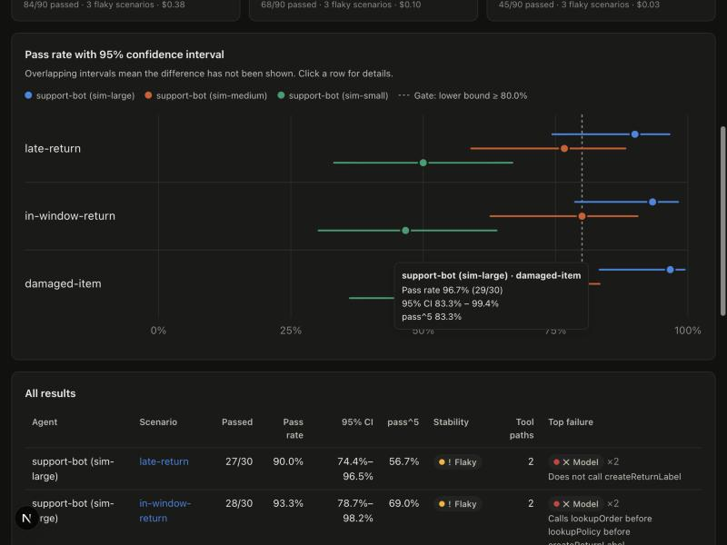

# RunLens

**Statistical reliability testing for AI agents.**

You ran your agent once and it gave the right answer. RunLens runs it 30 more times and tells
you how often it *actually* gets it right, how sure you can be, which tool-call paths lead to
failure, and whether a failure came from the model or from the world around it.

```
agent                     scenario          passed  rate   95% CI       stability  paths
support-bot (sim-large)   late-return       27/30   90.0%  74.4%–96.5%  flaky      2
support-bot (sim-medium)  late-return       23/30   76.7%  59.1%–88.2%  flaky      4
support-bot (sim-small)   late-return       15/30   50.0%  33.2%–66.8%  flaky      4
```



## Why

A single passing eval tells you very little about an LLM agent. Run the same scenario 20 times and
it may follow the policy 17 times, forget a condition twice and call the wrong tool once. That
isn't 85% reliability. With 20 runs, the 95% interval is **64%–95%**.

RunLens complements simulation frameworks such as [LangWatch Scenario](https://github.com/langwatch/scenario).
Those tools define *what* to test. RunLens adds *how much to trust the result*:

| | |
|---|---|
| **Repeated execution** | N runs per (agent, scenario), with concurrency, timeouts and retries for infrastructure errors |
| **Honest statistics** | Wilson intervals, pass@k, **pass^k** (τ-bench), flakiness and the number of runs needed for a ±5-point estimate |
| **Tool-path divergence** | Distinct tool-call sequences, the pass rate of each, and path entropy |
| **Failure attribution** | Every failure is labeled *model*, *environment* (a tool's result changed) or *infrastructure* (crash or timeout) |
| **Frozen tools** | Replays the first result for each tool call so only the model varies |
| **Failure & response clustering** | Groups failures by cause and path, and answers by similarity |
| **Regression detection** | One-sided Fisher exact test against a baseline, so noise doesn't fail your build |
| **CI gate** | Gates on the *lower bound* of the interval. Writes JUnit, Markdown and GitHub step summaries |
| **Dashboard** | Next.js app for comparing models and drilling into individual runs |

See [docs/methodology.md](docs/methodology.md) for the math and the reasoning behind each choice.

## Quick start

Requires Node 20+ and pnpm.

```bash
git clone https://github.com/saikiransangam/runlens-ai && cd runlens-ai
pnpm install && pnpm build
pnpm example      # 3 simulated models × 3 scenarios × 30 runs, no API keys needed
pnpm dashboard    # http://localhost:3210
```

The example in [`examples/customer-support`](examples/customer-support) simulates three
models with known failure tendencies against a return-policy support bot, using a slightly
flaky order service, so you can see every feature with ground truth. To compare real models,
use any OpenAI-compatible endpoint:

```bash
# Real models only, frozen tools (default: gpt-4.1-mini, gpt-5.4-nano, gpt-5.4-mini)
OPENAI_API_KEY=sk-... pnpm --filter customer-support-example run reliability:llm
RUNLENS_LLM_MODELS=gpt-4.1,gpt-5.4 OPENAI_API_KEY=sk-... pnpm --filter customer-support-example run reliability:llm
```

Errors that can't succeed on retry (bad key, no credits, unknown model) are not retried. After three
identical errors in a row, RunLens skips that model's remaining runs, so a misconfigured run costs a few
requests instead of hundreds. Throw `PermanentError` from your own agents to get the same behavior.

## Usage

### Library

```ts
import { ReliabilityRunner, mustCallTool, mustContain, mustNotCallTool } from "@runlens/core";

const runner = new ReliabilityRunner({ runs: 30, concurrency: 8, toolMode: "frozen" });

const report = await runner.evaluate(
  {
    name: "support-bot",
    model: "gpt-4.1-mini",
    tools: { lookupPolicy, lookupOrder, createReturnLabel },
    // Route tool calls through ctx.tools so RunLens can record and freeze them.
    run: async (input, ctx) => myAgent(input, { callTool: ctx.tools.call }),
  },
  {
    id: "late-return",
    input: "My order A-1001 arrived 40 days ago. Can I still return it?",
    criteria: [mustCallTool("lookupPolicy"), mustContain("30 days"), mustNotCallTool("createReturnLabel")],
  },
);

report.stats.passRate;          // 0.9
report.stats.passRateInterval;  // { low: 0.744, high: 0.965, level: 0.95 }
report.stats.passHatK["5"];     // 0.57: chance that 5 users in a row all get it right
report.toolPaths.groups;        // pass rate per tool-call path
report.failureClusters;         // [{ source: "model", label: "...", count: 2, ... }]
```

Criteria are plain functions, so you can write your own. Built-ins: `mustContain`,
`mustNotContain`, `mustMatch`, `mustCallTool`, `mustNotCallTool`, `toolOrder` and `llmJudge`
(provider-agnostic; `openAICompatible()` works with OpenAI, OpenRouter, vLLM, Ollama and others).

### CLI

```ts
// runlens.config.ts
import { defineConfig } from "@runlens/core";

export default defineConfig({
  name: "support-bot",
  agents: [agentA, agentB],
  scenarios,
  runs: 40,
  toolMode: "frozen",
  gate: { minPassRateLowerBound: 0.8 },
});
```

```bash
runlens run                               # writes .runlens/<id>/{report.json,junit.xml,summary.md}
runlens run --baseline main-report.json   # also flags statistically significant regressions
runlens compare base.json current.json    # REGRESSION vs. "within noise", with p-values
runlens sample-size --rate 0.85 --margin 0.05
```

`runlens run` exits with code 1 when the gate fails. See [.github/workflows/ci.yml](.github/workflows/ci.yml)
for a working CI gate.

### LangWatch Scenario

`@runlens/langwatch` wraps a [Scenario](https://github.com/langwatch/scenario) simulation so
it can be repeated and analyzed. Scenario's judge criteria become per-criterion pass rates, and
the tool calls in the transcript become tool paths:

```ts
import scenario from "@langwatch/scenario";
import { fromScenario } from "@runlens/langwatch";

const criteria = ["Agent states the 30-day return window", "Agent does not issue a return label"];

const { agent, scenario: s } = fromScenario({
  id: "late-return",
  agent: "support-agent",
  criteria,
  run: () =>
    scenario.run({
      name: "late return",
      description: "Customer wants to return headphones delivered 40 days ago.",
      agents: [supportAgent, scenario.userSimulatorAgent(), scenario.judgeAgent({ criteria })],
    }),
});

const report = await new ReliabilityRunner({ runs: 20 }).evaluate(agent, s);
```

## Repository layout

```
packages/
  core/        @runlens/core: runner, statistics, analyzers, criteria, gate, reporters
  cli/         runlens: CLI (run, compare, sample-size)
  langwatch/   @runlens/langwatch: LangWatch Scenario adapter
apps/
  dashboard/   Next.js dashboard that reads report.json files
examples/
  customer-support/   simulated + real-LLM support agents, comparison and CI configs
docs/
  methodology.md
```

## Development

```bash
pnpm install
pnpm build
pnpm test        # vitest
pnpm typecheck
```

## Status

Early prototype (v0.1). The APIs may change. Feedback and issues are welcome.

## License

MIT
